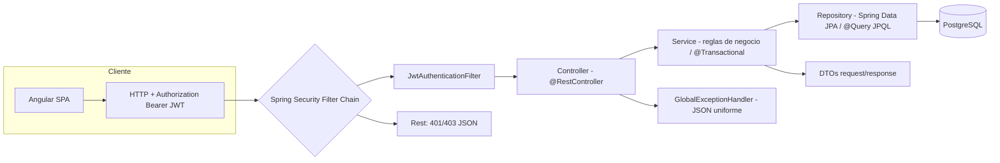

# TechStore — Sistema de Venta de Productos Tecnológicos

Proyecto Final — **Desarrollo Web Integrado** (Ingeniería de Sistemas e Informática · Lima Centro).

Aplicación web **full stack** de comercio electrónico de productos tecnológicos (laptops, celulares, periféricos, audio y componentes) con roles **ADMIN** y **CLIENTE**:

- **Backend:** API REST con Spring Boot 4.1.1, Spring Data JPA/Hibernate, Spring Security + **JWT**, Swagger/OpenAPI, tests (Mockito + MockMvc).
- **Frontend:** SPA en **Angular** (standalone, TypeScript, SASS).
- **Base de datos:** PostgreSQL.
- **Despliegue:** backend en Render/Railway y frontend en Vercel/Netlify.

> Este README documenta el backend completo (Fase 1). Las instrucciones de despliegue están en `docs/DESPLIEGUE.md`.

---

## 1. Tecnologías

| Capa | Tecnología |
|---|---|
| Backend | Java 21 · Spring Boot 4.1.1 · Spring Web MVC · Spring Data JPA · Spring Security 7 · JWT (jjwt 0.12.6) · OpenAPI (springdoc 3.1.1) |
| Base de datos | PostgreSQL 14+ (en local y en la nube) |
| Frontend | Angular 21 · TypeScript · SASS (`.scss`) · RxJS · Reactive Forms |
| Calidad | JUnit 5 · Mockito · MockMvc · H2 (perfil de test) |
| Herramientas | Maven · Git/GitHub · Postman |

## 2. Arquitectura por capas

El backend sigue una **arquitectura por capas** limpia (`com.sistematecnologico.*`):



```
src/main/java/com/sistematecnologico/
├── controller/      # Capa REST: Auth, Productos, Categorias, Pedidos, Admin, Reportes, Usuarios
├── service/         # Logica de negocio (constructor injection, @Transactional)
├── repository/      # Spring Data JPA + consultas JPQL (@Query) y derived queries
├── entity/          # Entidades JPA: Usuario, Categoria, Producto, Pedido, DetallePedido + enums
├── dto/             # DTOs de request/response (records) — nunca se exponen entidades
├── security/        # JwtService, JwtAuthenticationFilter, entry point, denegado, UserDetailsService
├── config/          # SecurityConfig, CORS, OpenApiConfig, DataInitializer
└── exception/       # @RestControllerAdvice + excepciones de negocio
```

## 3. Modelo de datos (entidades)

| Entidad | Relaciones | Notas |
|---|---|---|
| `Usuario` | `@OneToMany` → Pedidos | email único, password **BCrypt**, `rol` enum `@Enumerated(STRING)`, `activo`, `fechaRegistro` |
| `Categoria` | `@OneToMany` → Productos | nombre único |
| `Producto` | `@ManyToOne` → Categoria | precio `BigDecimal`, stock, marca, imagenUrl, `activo` (borrado lógico) |
| `Pedido` | `@ManyToOne` → Usuario · `@OneToMany(cascade=ALL, orphanRemoval=true)` → Detalles | estado enum `PENDIENTE/PAGADO/CANCELADO`, total calculado en backend |
| `DetallePedido` | `@ManyToOne` → Pedido · `@ManyToOne` → Producto | precioUnitario congelado al momento de la compra, subtotal |

Todas las relaciones son `FetchType.LAZY`. **Jamás se serializa una entidad JPA**: siempre se mapea a DTO dentro de la transacción.

## 4. Reglas de negocio (RN)

- **RN-01/06:** email único → si existe, `409 Conflict`.
- **RN-02/09:** validaciones con Bean Validation (`@NotBlank`, `@Email`, `@Size`, `@Positive`, `@Min`) → `400` con errores por campo.
- **RN-10:** errores controlados en JSON uniforme (timestamp, status, error, mensaje, path, errores) sin detalles técnicos.
- Registro público siempre crea rol **CLIENTE**; solo ADMIN crea/asigna ADMIN.
- Usuario con `activo=false` **no puede iniciar sesión**.
- Crear pedido: no permite producto inactivo ni stock insuficiente; **descuenta stock**; el **total lo calcula el backend**.
- Cancelar pedido: solo `PENDIENTE`, cliente solo el suyo; **devuelve stock**.
- No se elimina una categoría con productos ni un producto con pedidos (producto con historial → borrado lógico `activo=false`).

## 5. API REST (prefijo `/api`)

| Método | Ruta | Acceso | Descripción |
|---|---|---|---|
| POST | `/api/auth/registro` | Público | Registro (rol CLIENTE) → `{token, tipo, id, nombre, email, rol}` |
| POST | `/api/auth/login` | Público | Login → token JWT |
| GET | `/api/categorias` · `/api/categorias/{id}` | Público | Listar / obtener categorías |
| POST · PUT · DELETE | `/api/categorias[/{id}]` | ADMIN | CRUD de categorías |
| GET | `/api/productos?nombre=&categoriaId=&minPrecio=&maxPrecio=&page=&size=` | Público | Catálogo paginado y filtrable |
| GET | `/api/productos/{id}` | Público | Detalle de producto |
| POST · PUT · DELETE | `/api/productos[/{id}]` | ADMIN | CRUD de productos |
| POST | `/api/pedidos` | CLIENTE/ADMIN | Crear pedido `{items:[{productoId,cantidad}]}` |
| GET | `/api/pedidos/mis-pedidos` | CLIENTE/ADMIN | Historial propio |
| GET | `/api/pedidos/{id}` | propio / ADMIN | Detalle de pedido |
| PATCH | `/api/pedidos/{id}/cancelar` | propio / ADMIN | Cancelar (restaura stock) |
| GET | `/api/admin/pedidos?estado=&usuarioId=&desde=&hasta=` | ADMIN | Todos los pedidos |
| PATCH | `/api/admin/pedidos/{id}/estado` | ADMIN | Cambiar estado |
| GET · POST · PUT · PATCH · DELETE | `/api/admin/usuarios[/{id}]` | ADMIN | Gestión de usuarios (activo/rol) |
| GET · POST · PUT · DELETE | `/api/usuarios[/{id}]` | ADMIN | CRUD de usuarios |
| GET | `/api/admin/reportes/resumen` | ADMIN | KPIs |
| GET | `/api/admin/reportes/top-productos?limite=` | ADMIN | Más vendidos |
| GET | `/api/admin/reportes/ventas-por-categoria` | ADMIN | Ventas por categoría |
| GET | `/api/admin/reportes/stock-bajo?umbral=` | ADMIN | Stock bajo |
| GET | `/swagger-ui.html` | Público | Swagger UI (OpenAPI) |
| GET | `/actuator/health` | Público | Health check (despliegue) |

## 6. Seguridad

- `BCryptPasswordEncoder` para contraseñas.
- `JwtService` genera/valida JWT HS256 con claims `uid`, `rol`, `sub` (email).
- `JwtAuthenticationFilter` (stateless) valida el Bearer token y puebla el `SecurityContext`.
- `RestAuthenticationEntryPoint` → `401` JSON · `RestAccessDeniedHandler` → `403` JSON.
- Reglas: `/api/auth/**`, GET de productos/categorías, Swagger y `/actuator/health` públicos; `/api/admin/**` y escrituras → `ROLE_ADMIN`; `/api/pedidos/**` → `ROLE_CLIENTE` o `ROLE_ADMIN`.
- CORS global configurable vía `CORS_ORIGINS` (por defecto `http://localhost:4200`).

## 7. Cómo ejecutar en local

### Requisitos
- JDK 21, Maven (o el wrapper `mvnw`), PostgreSQL 14+.

### Base de datos
```sql
CREATE DATABASE sistema_tecnologico;
```
Las tablas se crean solas con `ddl-auto=update`. También puedes usar `docs/sql/techstore_schema.sql`.

### Variables de entorno (opcionales, tienen defaults locales)
| Variable | Default |
|---|---|
| `DB_URL` | `jdbc:postgresql://localhost:5432/sistema_tecnologico` |
| `DB_USER` | `postgres` |
| `DB_PASSWORD` | *(vacío)* |
| `JWT_SECRET` | clave de desarrollo (¡definir una propia en prod!) |
| `JWT_EXPIRATION` | `86400000` (24 h) |
| `CORS_ORIGINS` | `http://localhost:4200` |
| `PORT` | `8080` |

### Backend (3 comandos)
```bash
CREATE DATABASE sistema_tecnologico;   # 1. crear la BD (una vez)
# 2. (opcional) setear DB_PASSWORD=tuPassword
./mvnw clean test                       # 3a. compila y ejecuta todos los tests (H2)
./mvnw spring-boot:run                 # 3b. levanta contra PostgreSQL local :8080
```

### Frontend (SPA Angular 21)
```bash
cd frontend
npm install
npm start          # ng serve → http://localhost:4200 (API en http://localhost:8080/api)
npm run build      # build de producción
```

```
frontend/src/app/
├── core/            # models, services (auth, productos, categorias, pedidos, admin, carrito),
│                    # authInterceptor (Bearer + 401), guards (auth/admin/guest)
├── shared/          # navbar (con carrito y navegación por rol), not-found
├── features/        # home, catalogo (filtros+paginación), detalle, auth (login/registro),
│                    # carrito, pedidos (mis-pedidos)
│   └── admin/       # dashboard (KPIs), categorias, productos, pedidos, usuarios, reportes
├── app.config.ts    # provideRouter + provideHttpClient(withInterceptors)
├── app.routes.ts    # rutas con lazy loading y guards
└── environments/    # apiUrl dev/prod (fileReplacements en production)
```

## 8. Credenciales demo (creadas automáticamente por `DataInitializer`)

| Rol | Email | Contraseña |
|---|---|---|
| **ADMIN** | `admin@techstore.com` | `Admin123*` |
| **CLIENTE** | `cliente@techstore.com` | `Cliente123*` |

> **Importante:** los usuarios del avance anterior tenían contraseñas en **texto plano**. Con la migración a BCrypt **deben recrearse** (o usar el `DataInitializer` / el script SQL). No existe mecanismo automático de migración de hashes desde texto plano.

## 9. Consultas JPQL y derived queries (repositorios)

- `ProductoRepository` — `buscarConFiltros(...)` (@Query JPQL con filtros opcionales `:x IS NULL OR ...`), `productosStockBajo`, `productosEnRangoPrecio`, derived `existsByCategoriaId`.
- `PedidoRepository` — `historialPorUsuario`, `porEstadoYRangoFechas`, `buscarAdmin`, `totalVentas` (`SUM`), derived `countByEstado`.
- `DetallePedidoRepository` — `topProductos` (JOIN + GROUP BY + SUM, proyección a DTO), `ventasPorCategoria`.
- `UsuarioRepository` — derived `findByEmail`, `existsByEmail`, `existsByEmailAndIdNot`; JPQL `listarActivos`, `buscarPorTexto`.
- `CategoriaRepository` — derived `existsByNombreIgnoreCase`, `existsByNombreIgnoreCaseAndIdNot`.

## 10. Tests

- **Unitarios (Mockito):** `PedidoServiceTest` (stock, cancelación, total, permisos), `AuthServiceTest` (login, rol inactivo, registro).
- **Integración (MockMvc + H2):** `AuthIntegrationTest` — flujo completo registro→login→roles→pedido→cancelación→reportes.

```bash
./mvnw test
```

## 11. Documentación y evidencias (carpeta `docs/`)

- `docs/sql/techstore_schema.sql` — DDL PostgreSQL + inserts con hashes BCrypt.
- `docs/postman/TechStore.postman_collection.json` — colección completa (variable `{{token}}` se guarda sola tras el login).
- `docs/INFORME_SEMANA10_APOYO.md` — contenido técnico listo para el Modelo de Informe + lista de capturas.
- `docs/DESPLIEGUE.md` — pasos exactos para Render/Railway + Vercel/Netlify.
- `Dockerfile` — imagen multi-stage JDK 21 para el backend.

## 12. Decisiones técnicas y limitaciones

- **Spring Boot 4.1.1 + Jackson 3:** `jjwt-jackson` arrastra Jackson 2.x y provoca conflicto de clases con Jackson 3 (`tools.jackson`). Se eligió **`jjwt-gson`** (mismo API JJWT, 0.12.6) para evitarlo sin bajar de versión de Spring Boot.
- **Verificación sin PostgreSQL:** los credenciales de PostgreSQL local no estaban disponibles durante el desarrollo, por lo que los tests y la verificación del flujo completo se ejecutan con **H2 en modo PostgreSQL** (perfil `h2`). El arranque en producción/es local contra PostgreSQL requiere definir `DB_URL`/`DB_USER`/`DB_PASSWORD` (documentado arriba).
- **DTOs y registro:** se usan `record` de Java para DTOs (inmutables, sin Lombok) y Lombok para las entidades JPA.
- **Paginación:** respuestas paginadas a través de `PageResponse<T>` (evita serializar `PageImpl`).
- **Borrado:** productos con historial de pedidos se desactivan en vez de borrarse; categorías con productos no se eliminan.